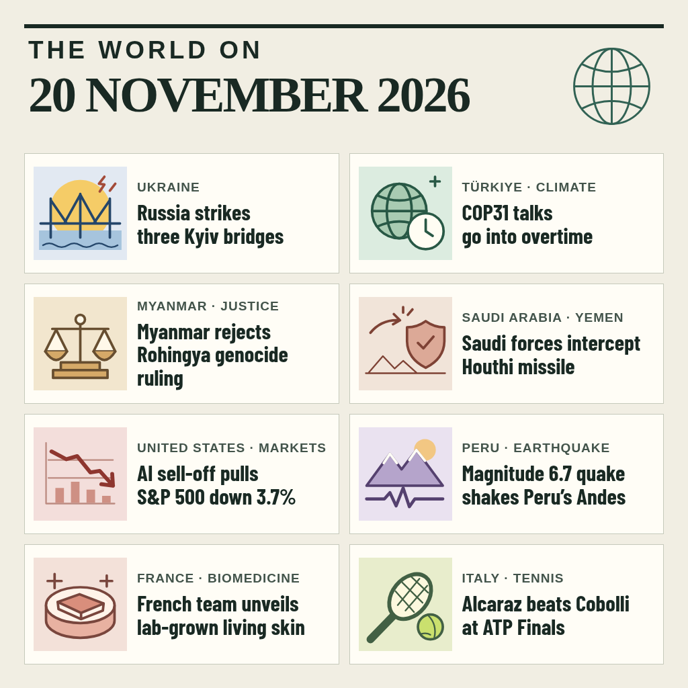

# The World on 20 November 2026

Eight illustrated headlines from Friday, 20 November 2026. See [NEWS.md](NEWS.md) for reporting and date checks.

Run `mkdir -p out && MAKEFUN_OUTPUT_DIR=out node main.ts` to write the contest output. To regenerate the poster, run `node render/render.mjs` with Google Chrome and Barlow Condensed installed.
